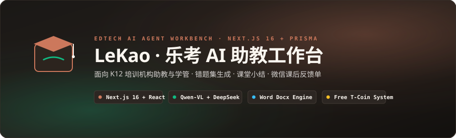

<div align="center">



<br/>

[](LICENSE)
[](https://lekao.asterforge.top)
[](https://nextjs.org)
[](https://prisma.io)

<br/>

**让培训机构助教从"抄错题、写小结、写反馈"的繁复工作里解放出来，每次课省 1-2 小时。**

[🌐 在线体验](https://lekao.asterforge.top) · [📝 功能介绍](#-项目定位) · [🛠 技术架构](#-技术栈)

</div>

---

## ✨ 项目定位

**LeKao** 是一款面向 K12 培训机构助教 / 学管 / 班主任的 AI 工作台：

- 📝 **课堂小结**：上传讲义图片，AI 自动识别学科 + 章节 + 知识点，按 BRD 硬约束格式生成"10 条反馈 + 一段小结"
- 📋 **作业/堂测反馈**：上传讲义图片，AI 生成逐题反馈 + 作业总体小结（5 挡字数：×0.5/标准/×1.5/×2/×3）
- 📚 **错题集 Word 生成**：Excel 模板 + 拖拽题目图片 → 5 分钟生成全班 Word 错题文档（**永久免费**）
- 💰 **T-Coin 体系（免费）**：每日签到领币（连续签到 7 日递增 2-8 币），AI 生成消耗 1 币/次，生成失败自动退款——不付费、不充值

**目标用户**：K12 培训机构助教（每次课抄错题、写小结、写反馈要 1-2 小时）

---

## 🛠 技术栈

| 层        | 选型                                       | 理由                                      |
| --------- | ------------------------------------------ | ----------------------------------------- |
| 前端      | **Next.js 16** App Router + React 19       | SSR + 流式响应 + Server Components        |
| 样式      | **Tailwind 4** + 设计 token                | 主题色：`--ink` / `--canvas` / `--signal` |
| 数据库    | **PostgreSQL** + Prisma 6                  | 类型安全 + Migration 管控                 |
| 认证      | **next-auth v4** + JWT                     | 邮箱密码 + 邮箱验证码                     |
| 视觉模型  | **Qwen3-VL-8B-Instruct**（硅基流动）       | 读图提取学科/章节/知识点                  |
| 文本模型  | **DeepSeek-V4-Flash**                      | 低延迟 + 标准输出                         |
| 部署      | 腾讯云 3.6GB 单进程 + nginx 反代           | systemd + cgroup v2 监控                  |
| Word 生成 | **docx** 库 + **JSZip**                    | 纯前端生成 .docx                          |
| 图片压缩  | **browser-image-compression** + Web Worker | 移动端自动降级（1280px / 0.4MB）          |

---

## 📁 目录结构

```
lekao/
├── src/
│   ├── app/
│   │   ├── (marketing)/      # 公开站（landing + about + privacy + terms）
│   │   ├── api/              # 后端路由（auth + summarize + feedback + ideas + checkin + templates + admin）
│   │   ├── dashboard/        # 登录后（summary / feedback / mistake / weekend-mistake / ideas / history / profile）
│   │   ├── login/            # 登录
│   │   ├── register/         # 注册
│   │   ├── admin/            # 管理员后台（users / coin-log / audit-log / ideas / analytics / invite-codes / settings / history）
│   │   ├── banned/           # 封禁提示页
│   │   ├── icon.tsx          # Favicon（动态生成）
│   │   ├── apple-icon.tsx    # Apple Touch Icon
│   │   ├── opengraph-image.tsx # 社交分享卡片
│   │   ├── robots.ts         # robots.txt
│   │   ├── sitemap.ts        # sitemap.xml
│   │   └── layout.tsx        # 根布局 + 全局 metadata
│   ├── components/
│   │   ├── landing/          # Hero + FeatureCards + Stats + FAQ
│   │   ├── summary/          # 课堂小结 + 反馈生成 UI
│   │   ├── mistake/          # 错题集生成 UI
│   │   ├── deliver/          # 四工作流统一交付面板（打印 / PDF / 批量导出）
│   │   ├── icons/            # SVG 图标库
│   │   └── ...
│   ├── lib/
│   │   ├── ai/               # prompts + vision + text（DeepSeek / Qwen 封装）
│   │   ├── auth.ts           # next-auth 配置（JWT + 验证码 + 赠币初始化）
│   │   ├── coin.ts           # T-Coin 计费门面（reserve / settle / release）
│   │   ├── coin-ledger.ts    # T-Coin 幂等计费账本（S01 状态机）
│   │   ├── checkin.ts        # 每日签到（七日循环 2-8 币）
│   │   ├── image-compress.ts # 共享图片压缩工具（移动端降级）
│   │   ├── storage/          # IndexedDB 本地历史
│   │   ├── mistake/          # 错题集 Excel 解析 + Word 生成
│   │   ├── deliver/          # 交付渲染（docx / xlsx / 打印视图）
│   │   ├── workflow/         # 四工作流统一步骤模型
│   │   ├── summary/          # 小结输出解析
│   │   ├── prisma.ts         # Prisma Client 单例
│   │   └── ...
│   └── proxy.ts              # ⭐ banned 中间件（Next 16 改名 middleware → proxy）
├── prisma/
│   ├── schema.prisma         # 数据模型
│   └── migrations/           # 迁移历史（**禁 db push --force**）
├── e2e/                      # Playwright e2e（auth / content-claims / dashboard / fullflow / 视觉基线）
├── scripts/
│   ├── deploy-production.ps1 # 一键部署（git bundle + SCP + fetch + rebuild）
│   ├── perf-audit.mjs        # 路由性能审计（pnpm perf:audit）
│   ├── e2e-*.mjs             # e2e 环境与全流程支撑
│   └── gen-word-template.ts  # 错题 Word 模板生成（运维 / 生成类）
├── docs/
│   ├── PRD.md                # 产品需求文档（v0.6）
│   ├── BRD.md                # 业务需求文档
│   └── ARCHITECTURE.md       # 系统架构图
└── public/
    └── lekao-mark.svg        # Logo 矢量源
```

---

## 🚀 本地开发

### 前置条件

- Node 20+ / pnpm
- PostgreSQL 14+
- DeepSeek API Key（[deepseek.com](https://deepseek.com)）
- 硅基流动 API Key（[siliconflow.cn](https://siliconflow.cn)）

### 安装步骤

```bash
# 1. 安装依赖
pnpm install

# 2. 配置环境变量
cp .env.example .env
# 编辑 .env：DATABASE_URL / DEEPSEEK_API_KEY / SILICONFLOW_API_KEY

# 3. 数据库迁移
pnpm prisma migrate deploy

# 4. 启动开发服务器
pnpm dev
# → http://localhost:3007（NEXTAUTH_URL 默认端口，与 nginx / systemd 一致）
```

---

## 📦 部署

### 一键部署到腾讯云

```powershell
pwsh scripts/deploy-production.ps1
```

**部署流程**：

1. 本地 `git bundle create <file> main`
2. SCP bundle + `.env` 到腾讯云
3. 服务器 `git fetch <bundle> main:main-new` + `reset --hard`
4. `pnpm build` + `systemctl restart lekao-web`

**架构**：

```
[用户] → https://lekao.asterforge.top
        ↓ 腾讯云 nginx 终止 TLS 并反代（单层，无阿里云中转）
       Lekao Next.js (127.0.0.1:3007 systemd)
        ↓ Prisma 6 connection_limit=4
       PostgreSQL localhost:5432/lekao
```

详见 [docs/ARCHITECTURE.md](./docs/ARCHITECTURE.md)

---

## 🔒 核心安全设计

详见 [PRD §3.4.1 + §9 P0](./docs/PRD.md)：

1. **共享 users 表只读**：Lekao 永远不修改 ResumeAIX 共享的 users 表结构（**禁 `prisma db push --force`**）
2. **Prisma 连接池**：`.env` DATABASE_URL 必须带 `?connection_limit=4&pool_timeout=20`
3. **延迟初始化赠币**：`lekao_gift_coin` 默认 -1，signIn callback 检测 == -1 才补发 5 枚
4. **banned 四层拦截**：`authorize` + `signIn` callback + `verify-code` + `proxy.ts`
5. **全局并发限流**：summarize 5 并发 + 队列 + 60s 超时（防 AI provider 滥用）
6. **Rate Limit**：每用户 5 次 / 60s（防刷）
7. **AI 错误友好提示**：402 余额不足 / 429 限流 / 超时 → 转成 SSE `__ERROR__` 事件，前端展示友好文案

---

## 📊 监控

- **systemd + cgroup v2** memory 监控（`/usr/local/bin/lekao-monitor.sh` 每 5 分钟）
- **QQ SMTP 告警**：超过 80% 内存 / 进程死掉立刻推送到 QQ 邮箱
- **nginx limit_req**：20r/s + burst 50（防 DDoS）

---

## 🤝 致谢

- 视觉模型：[Qwen3-VL-8B-Instruct](https://qwenlm.github.io/)（通义千问团队）
- 文本模型：[DeepSeek-V4-Flash](https://deepseek.com)（深度求索）
- 图像压缩：[browser-image-compression](https://github.com/Donaldcwl/browser-image-compression)
- Word 生成：[docx](https://docx.js.org/)
- 界面动效：[motion](https://motion.dev/)

---

## 📄 许可证

Private · 暂不开源

---

<p align="center">
  
  <br />
  <sub>© 2026 LeKao · AI 智能助教助手</sub>
</p>
