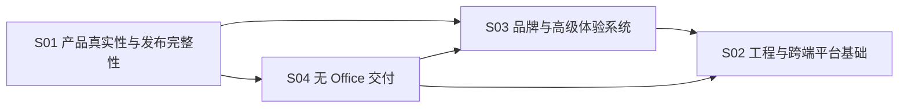

# LeKao 基础升级交付路线图

## 交付原则

- 先恢复产品可信度（S01），再补纯客户端产物层（S04），然后统一品牌与工作台体验（S03），最后收工程与跨端契约（S02）。
- 每个 Stage 独立 planning commit、逐 Task 逻辑提交、独立检查与 Final judge 验收。
- 后一 Stage 不得通过重写前一 Stage 的契约绕开失败项。
- 安全工作不在本路线图范围内。

## 阶段顺序修订（2026-10-02）

原顺序 S01 → S02 → S03 调整为 S01 → S04 → S03 → S02，理由与代价：

- S04 是纯客户端产物层（浏览器内渲染/编辑/打印），不依赖 S02 的 API 与 Artifact 真值，先落地可避免 S03 重做四条流程的交付视图。
- S02 后置让 Web/API 契约在一次冻结后直接被 Android 消费，避免为对齐而反复改契约。
- 代价：S03/S04 的交付步在 S02 之前只能展示本地保存状态（IndexedDB / history.json）；统一 Artifact 状态接入由 S02 承接，S03/S04 不得自行发明服务端状态。

## 阶段依赖

## Stage 门禁

| Stage | 开始条件                                       | 结束条件                                                   | 外部证据                                          |
| ----- | ---------------------------------------------- | ---------------------------------------------------------- | ------------------------------------------------- |
| S01   | 独立 planning commit                           | AC-001/002/003/004/010/012 全部满足                        | 测试数据库、可控 AI 失败                          |
| S04   | S01 SEALED                                     | 渲染保真、就地编辑、打印/PDF、落表与产物不出浏览器均有证据 | 真实浏览器、打印预览、Office/WPS 对照、脱敏反馈表 |
| S03   | S01、S04 SEALED；内容真值已冻结                | 响应式、性能、内容与设计验收通过                           | 真实浏览器、人工品牌/内容评审                     |
| S02   | S01、S03、S04 SEALED；共享 users 表 owner 明确 | API contract、Artifact restore、全局质量门禁通过           | Android JDK/模拟器或真机                          |

## 根因到 Stage 映射

| 根因                              |        S01         |           S02           |           S03            |
| --------------------------------- | :----------------: | :---------------------: | :----------------------: |
| 产品声明没有单一真值              |        主修        |         契约化          |         消费真值         |
| 计费副作用无状态机                |        主修        |       可观测/回归       |       展示账务状态       |
| Web/Android 手写契约漂移          |        止损        |          主修           |           N/A            |
| 本地/服务端/Android 数据割裂      |      暴露状态      |          主修           |         统一交互         |
| 质量门禁与模块边界缺失            |      局部测试      |          主修           |         保持门禁         |
| 泛 SaaS 视觉和内部语言            |      文案止损      |     token/组件基础      |           主修           |
| 奖励/余额抢占核心任务             | 保证账务与签到正确 |    提供最近任务数据     |      重排工作台层级      |
| 视觉隐喻无业务语义                |    移除误导声明    | 建立 build/content 真值 |    以设计系统统一治理    |
| 生成件不可信、交付依赖本机 Office |      声明止损      |      跨端交付回退       | S04 主修；S03 统一交付步 |

## 交付包索引

| Stage | Spec                                         | Tasks                                        | Prompt                                                                 | Handoff                                   |
| ----- | -------------------------------------------- | -------------------------------------------- | ---------------------------------------------------------------------- | ----------------------------------------- |
| S01   | `../stages/S01-product-integrity.spec.md`    | `../tasks/S01-product-integrity.tasks.md`    | `../prompts/S01-product-integrity-implementer-01.implementation.md`    | `../handoffs/S01-product-integrity.md`    |
| S02   | `../stages/S02-platform-foundation.spec.md`  | `../tasks/S02-platform-foundation.tasks.md`  | `../prompts/S02-platform-foundation-implementer-01.implementation.md`  | `../handoffs/S02-platform-foundation.md`  |
| S03   | `../stages/S03-advanced-experience.spec.md`  | `../tasks/S03-advanced-experience.tasks.md`  | `../prompts/S03-advanced-experience-implementer-01.implementation.md`  | `../handoffs/S03-advanced-experience.md`  |
| S04   | `../stages/S04-office-free-delivery.spec.md` | `../tasks/S04-office-free-delivery.tasks.md` | `../prompts/S04-office-free-delivery-implementer-01.implementation.md` | `../handoffs/S04-office-free-delivery.md` |

规划包已于 2026-10-02 形成独立 docs-only planning commit（含 S04 阶段包），全部规格重绑 `4a5780e92215fbe01db87b5e1827465135253efa`：S01 Handoff 为 `READY`，S02/S03/S04 因上游未 SEALED、脚本入口未建立或评审 owner 未登记而保持 `BLOCKED`。
